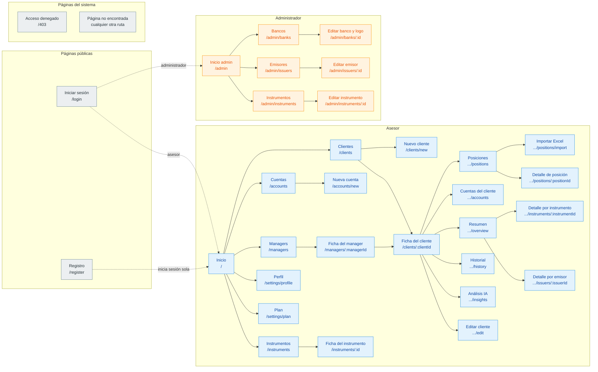

# Páginas del sitio y datos que usa cada una

Este documento lista todas las páginas que va a tener la aplicación web de Abakus. Para cada una explica qué tiene que hacer, qué tiene que mostrar y qué pedidos le hace al servidor (la API) para conseguir o guardar la información.

## Antes de empezar: cómo leer este documento

Cada página aparece con este formato:

- **`/ruta`** - pedidos al servidor que hace
  - **Qué hace:** para qué sirve la página.
  - **Qué contiene:** qué elementos tiene que ver el usuario.

Algunas palabras que se repiten:

- **Ruta:** la dirección que aparece en el navegador después del dominio. Por ejemplo, en `abakus.vercel.app/clients`, la ruta es `/clients`. Cuando una ruta tiene una parte con dos puntos, como `/clients/:clientId`, esa parte cambia según el elemento que se esté viendo (por ejemplo, el identificador de un cliente).
- **Pedido al servidor (endpoint):** cada vez que la página necesita traer, crear, modificar o borrar información, le hace un pedido a la API. Se escriben como `GET /client`. La primera palabra indica qué tipo de pedido es:
  - `GET`: traer información (por ejemplo, la lista de clientes).
  - `POST`: crear algo nuevo.
  - `PATCH`: modificar algo que ya existe.
  - `DELETE`: dar de baja algo.
- Todos los pedidos empiezan con `/v1`, que se omite en este documento para que sea más fácil de leer. Por ejemplo, `GET /client` en realidad es `GET /v1/client`.
- Los pedidos marcados como **(propuesto)** todavía no existen en el servidor y habría que agregarlos.

### Los dos tipos de usuario

- **Asesor (advisor):** es la firma que gestiona inversiones. Se registra solo desde la página de registro. Administra sus clientes, las cuentas bancarias de esos clientes, sus managers (los empleados que atienden a cada cliente) y las posiciones (las inversiones que tiene cada cliente). Ve solamente su propia información.
- **Administrador (admin):** ya viene creado en el sistema y no se puede registrar desde la web. Mantiene las listas que comparten todos los asesores: bancos, emisores (las empresas o gobiernos que emiten acciones y bonos) e instrumentos (las acciones, bonos y fondos en sí).

Cada tipo de usuario ve su propio menú. Si un asesor intenta entrar a una página de administrador, se le muestra la página de "acceso denegado".

### El límite del plan

Los asesores empiezan en el plan **base**, que permite como máximo **4 clientes activos** y **4 cuentas bancarias activas**. El plan **premium** no tiene límite. Mientras el asesor esté en el plan base, el sitio muestra en todo momento cuánto lleva usado. Cuando llega al límite, los botones para agregar clientes o cuentas se desactivan y se le ofrece pasar a premium.

---

## Mapa del sitio

Este esquema muestra todas las páginas y cómo se relacionan. Cada caja es una página: arriba va su nombre y abajo su ruta. Las flechas continuas van de una sección a las páginas que contiene. Las flechas punteadas indican hacia dónde se lleva al usuario después de iniciar sesión o registrarse, según su tipo.

Los colores distinguen quién puede ver cada página:

- **Gris:** páginas públicas y del sistema, que puede ver cualquiera.
- **Azul:** páginas del asesor.
- **Naranja:** páginas del administrador.

> El esquema se ve como dibujo en GitHub y en la vista previa de Markdown de VS Code. Si en algún lugar aparece como texto, se puede pegar el bloque en [mermaid.live](https://mermaid.live) para verlo.

Las rutas que empiezan con `...` están dentro de la ficha del cliente. Por ejemplo, `.../overview` es en realidad `/clients/:clientId/overview`.

---

## Páginas públicas

Se pueden ver sin haber iniciado sesión. Si alguien que ya inició sesión entra a una de estas páginas, se lo lleva directamente a su página de inicio.

- **`/login`** - `POST /auth/login`
  - **Qué hace:** permite iniciar sesión con usuario y contraseña. Si los datos son correctos, lleva al inicio del asesor o del administrador, según quién sea.
  - **Qué contiene:** campos de usuario y contraseña; un botón "Ingresar" que permanece desactivado mientras alguno de los dos campos esté vacío; el mensaje de error que devuelva el servidor, mostrado en la misma página (sin ventanas emergentes); y un enlace a la página de registro.

- **`/register`** - `POST /auth/register`, `POST /auth/login`
  - **Qué hace:** permite que una firma asesora cree su cuenta. Al terminar el registro, la sesión se inicia sola, sin tener que volver a escribir los datos.
  - **Qué contiene:** usuario, contraseña y un campo para repetir la contraseña; los datos de la firma (nombre comercial, razón social, documento, teléfono, correo de contacto y, de forma opcional, dirección y país). Cada campo muestra su error al lado si el dato no es válido, y el botón "Registrarse" permanece desactivado hasta que todo esté correcto. Los errores del servidor (por ejemplo, un usuario que ya existe) se muestran en la misma página.

---

## Páginas del asesor

Todas comparten un menú lateral con las secciones principales y un indicador del uso del plan, que siempre está a la vista. El menú también tiene la opción "Cerrar sesión", que no necesita ningún pedido al servidor: alcanza con olvidar la sesión en el navegador y volver a `/login`.

### Inicio

- **`/`** - `GET /user/me`, `GET /user/me/plan`, `GET /client`
  - **Qué hace:** es la primera pantalla después de iniciar sesión. Da un resumen rápido de la actividad del asesor.
  - **Qué contiene:** un saludo con el nombre de la firma; el uso del plan (en el plan base, el porcentaje usado de los 4 clientes y de las 4 cuentas; en premium, la cantidad total); un botón para pasar a premium si corresponde; los totales de clientes y cuentas; y accesos rápidos a los clientes más recientes.

### Clientes

- **`/clients`** - `GET /client`, `GET /manager`, `GET /bank`
  - **Qué hace:** muestra todos los clientes del asesor y permite buscarlos.
  - **Qué contiene:** una tabla o tarjetas con nombre comercial, país, manager asignado y cantidad de cuentas; filtros por nombre, país, manager, banco y región; paginación (de a 10 clientes por página); y un botón "Nuevo cliente", que se desactiva si se llegó al límite del plan.

- **`/clients/new`** - `POST /client`, `POST /client/:clientId/uploadImage`, `GET /manager`, `GET /bank`, `GET /user/me/plan`
  - **Qué hace:** permite dar de alta un cliente nuevo y, si se quiere, agregarle cuentas bancarias desde el principio.
  - **Qué contiene:** nombre comercial, razón social, dirección y país; un selector para elegir el manager que lo va a atender; una sección opcional para agregar cuentas (banco, número de cuenta, nombre de la cuenta y moneda); y la opción de subir el logo del cliente. Avisa antes de guardar si las cuentas agregadas superan el límite del plan.

- **`/clients/:clientId`** - `GET /client/:clientId`
  - **Qué hace:** es la ficha de un cliente. Funciona como un contenedor con pestañas: cada pestaña es una de las páginas que siguen.
  - **Qué contiene:** arriba, el logo, el nombre y el manager del cliente, junto con un botón "Editar". Debajo, las pestañas Resumen, Cuentas, Posiciones, Historial y Análisis IA. Si se entra sin elegir una pestaña, se abre Resumen.

- **`/clients/:clientId/overview`** - `GET /report/client/:clientId`, `GET /report/client/:clientId/composition`
  - **Qué hace:** muestra la foto completa de las inversiones del cliente, sumando lo que tiene en todos sus bancos.
  - **Qué contiene:** el valor total de la cartera; un gráfico con cómo se reparte ese total por banco, por moneda o por tipo de instrumento (con un selector para cambiar de vista); y una lista de los instrumentos y emisores principales, donde cada uno lleva a su página de detalle.

- **`/clients/:clientId/accounts`** - `GET /client/:clientId`, `PATCH /client/:clientId`, `GET /bank`, `GET /user/me/plan`
  - **Qué hace:** muestra y administra las cuentas bancarias de este cliente.
  - **Qué contiene:** la lista de cuentas con banco, número, nombre y moneda; un botón para editar cada cuenta directamente en la fila, sin cambiar de página; un botón para darla de baja (con un mensaje de confirmación previo); y un botón para agregar una cuenta, desactivado si se llegó al límite. Una aclaración importante: el banco y el número de una cuenta no se pueden cambiar después de creada. Si están mal, hay que dar de baja la cuenta y crear una nueva.

- **`/clients/:clientId/positions`** - `GET /position?clientId=`, `POST /position`, `PATCH /position/:positionId`, `DELETE /position/:positionId`, `GET /instrument`
  - **Qué hace:** muestra las inversiones (posiciones) que tiene el cliente en cada una de sus cuentas.
  - **Qué contiene:** una tabla con instrumento, cuenta, cantidad, precio de compra, valor actual, moneda y fecha; filtros por tipo de instrumento, moneda y rango de fechas; un botón para cargar una posición a mano; y otro para importarlas desde un archivo Excel.

- **`/clients/:clientId/positions/import`** - `POST /position`, `GET /client/:clientId`
  - **Qué hace:** permite cargar de una sola vez muchas posiciones a partir del archivo Excel que entrega el banco.
  - **Qué contiene:** un lugar para elegir o arrastrar el archivo; un selector de la cuenta a la que corresponde; una vista previa de las filas leídas, con las que tienen errores marcadas; y un botón "Confirmar importación".

- **`/clients/:clientId/positions/:positionId`** - `GET /position/:positionId`, `PATCH /position/:positionId`
  - **Qué hace:** muestra el detalle de una posición y permite corregirla.
  - **Qué contiene:** todos los datos de la posición en un formulario editable. El cliente y la cuenta se muestran, pero no se pueden cambiar.

- **`/clients/:clientId/history`** - `GET /report/client/:clientId/historic`
  - **Qué hace:** muestra cómo fue cambiando el valor de la cartera del cliente con el paso del tiempo.
  - **Qué contiene:** un gráfico de línea con el valor total por fecha y, debajo, la misma información en una tabla.

- **`/clients/:clientId/insights`** - `GET /report/client/:clientId/news?lang=`
  - **Qué hace:** muestra un análisis de la cartera escrito por inteligencia artificial, con comentarios sobre concentración, riesgo y noticias relevantes.
  - **Qué contiene:** el texto del análisis; un selector de idioma (español o inglés); y un indicador de "cargando" mientras se genera, porque puede tardar unos segundos.

- **`/clients/:clientId/instruments/:instrumentId`** - `GET /report/client/:clientId/instrument/:instrumentId`
  - **Qué hace:** muestra cuánto tiene el cliente invertido en un instrumento puntual (por ejemplo, en una acción) y en qué cuentas.
  - **Qué contiene:** el nombre y el tipo del instrumento, la cantidad total, el valor total, y el detalle por cuenta y banco.

- **`/clients/:clientId/issuers/:issuerId`** - `GET /report/client/:clientId/issuer/:issuerId`
  - **Qué hace:** muestra cuánto tiene el cliente invertido en un mismo emisor (por ejemplo, todas sus acciones y bonos de una misma empresa).
  - **Qué contiene:** el nombre del emisor, el valor total invertido en él y la lista de instrumentos de ese emisor que tiene el cliente.

- **`/clients/:clientId/edit`** - `GET /client/:clientId`, `PATCH /client/:clientId`, `DELETE /client/:clientId`, `POST /client/:clientId/uploadImage`, `GET /manager`
  - **Qué hace:** permite modificar los datos del cliente, cambiar su logo o darlo de baja.
  - **Qué contiene:** el mismo formulario que el alta, con los datos ya cargados; la opción de reemplazar el logo; y un botón "Dar de baja cliente". Ese botón solo funciona si el cliente ya no tiene cuentas activas; si las tiene, se muestra un mensaje que lo explica.

### Cuentas

- **`/accounts`** - `GET /client/accounts` (propuesto; mientras no exista, se puede usar `GET /client`), `PATCH /client/:clientId`, `GET /bank`, `GET /user/me/plan`
  - **Qué hace:** reúne en una sola lista las cuentas bancarias de todos los clientes del asesor. Es una de las pantallas principales que pide la letra del obligatorio.
  - **Qué contiene:** una tabla con cliente, banco, número, nombre de la cuenta, moneda y estado (activa o dada de baja); filtros por banco, cliente, moneda y estado; en cada fila, un botón "Editar" (edición en la misma fila) y al lado un botón "Eliminar"; y un botón "Nueva cuenta", desactivado si se llegó al límite del plan.

- **`/accounts/new`** - `GET /client`, `GET /bank`, `PATCH /client/:clientId`, `GET /user/me/plan`
  - **Qué hace:** permite crear una cuenta bancaria nueva para cualquiera de los clientes del asesor.
  - **Qué contiene:** un selector de cliente, un selector de banco, el número de cuenta, el nombre de la cuenta y la moneda. Si el plan ya no permite más cuentas, en lugar del formulario se muestra un aviso con el botón para pasar a premium.

### Managers

- **`/managers`** - `GET /manager`, `POST /manager`, `PATCH /manager/:managerId`, `DELETE /manager/:managerId`
  - **Qué hace:** permite administrar a los empleados de la firma que atienden a los clientes.
  - **Qué contiene:** una lista con nombre completo y correo; un botón "Nuevo manager", que abre un formulario en una ventana sobre la misma página; y, en cada fila, botones para editar y dar de baja. Un manager no se puede dar de baja si todavía tiene clientes asignados.

- **`/managers/:managerId`** - `GET /manager/:managerId`, `GET /client?managerId=`
  - **Qué hace:** muestra la ficha de un manager y los clientes que tiene a cargo.
  - **Qué contiene:** el nombre y el correo del manager y la lista de sus clientes, donde cada uno lleva a su ficha.

### Instrumentos

- **`/instruments`** - `GET /instrument`, `POST /instrument`
  - **Qué hace:** muestra el catálogo de instrumentos (acciones, bonos, fondos) que comparten todos los asesores, y permite agregar uno nuevo.
  - **Qué contiene:** una lista con nombre, ticker (el código bursátil, por ejemplo AAPL), ISIN y tipo; filtros por tipo, nombre o ticker, e ISIN; y un botón "Agregar instrumento" en el que solo se escribe el código ISIN: el sistema completa el resto de los datos automáticamente.

- **`/instruments/:id`** - `GET /instrument/:id`, `GET /issuer/:id`
  - **Qué hace:** muestra la ficha de un instrumento del catálogo.
  - **Qué contiene:** todos sus datos (nombre, tipo, ticker, ISIN, mercado) y el emisor al que pertenece.

### Configuración

- **`/settings/profile`** - `GET /user/me`
  - **Qué hace:** muestra los datos de la firma asesora que se cargaron al registrarse.
  - **Qué contiene:** usuario, nombre comercial, razón social, documento, teléfono, correo, dirección y país, solo para consulta.

- **`/settings/plan`** - `GET /user/me/plan`, `PATCH /user/me/plan`
  - **Qué hace:** muestra el plan actual en detalle y permite pasar a premium.
  - **Qué contiene:** el plan actual; el uso de clientes y de cuentas (en porcentaje en el plan base, en cantidad en premium); una comparación entre los dos planes; y el botón "Pasar a premium", con confirmación previa. Ese botón no aparece si el asesor ya es premium, porque no se puede volver al plan base.

---

## Páginas del administrador

Tienen su propio menú y no muestran el indicador de plan, porque el administrador no tiene plan. Al entrar a `/admin` se abre directamente la página de bancos.

- **`/admin/banks`** - `GET /bank`, `POST /bank`, `DELETE /bank/:id`
  - **Qué hace:** permite administrar la lista de bancos que los asesores eligen al crear cuentas.
  - **Qué contiene:** una lista con logo, nombre, país y región; filtros por país y región; un botón "Nuevo banco"; y, en cada fila, un botón para darlo de baja. Un banco no se puede dar de baja mientras tenga cuentas activas; en ese caso se muestra un mensaje que lo explica.

- **`/admin/banks/:id`** - `GET /bank/:id`, `PATCH /bank/:id`, `POST /bank/:id/uploadImage`
  - **Qué hace:** permite modificar los datos de un banco y subir o cambiar su logo.
  - **Qué contiene:** un formulario con los datos del banco y una sección para subir el logo, con vista previa de la imagen. Solo se aceptan imágenes y hay un tamaño máximo.

- **`/admin/issuers`** - `GET /issuer`, `POST /issuer`, `DELETE /issuer/:id`
  - **Qué hace:** permite administrar la lista de emisores, es decir, las empresas o gobiernos que emiten acciones y bonos.
  - **Qué contiene:** una lista paginada de emisores, un botón "Nuevo emisor" y, en cada fila, un botón para darlo de baja. Un emisor no se puede dar de baja si tiene instrumentos asociados.

- **`/admin/issuers/:id`** - `GET /issuer/:id`, `PATCH /issuer/:id`
  - **Qué hace:** permite modificar los datos de un emisor.
  - **Qué contiene:** un formulario con los datos del emisor ya cargados.

- **`/admin/instruments`** - `GET /instrument`, `POST /instrument`, `DELETE /instrument/:id`
  - **Qué hace:** permite al administrador revisar y depurar el catálogo de instrumentos.
  - **Qué contiene:** la misma lista y los mismos filtros que ve el asesor, más un botón para dar de baja cada instrumento. Un instrumento no se puede dar de baja si algún cliente lo tiene en sus posiciones.

- **`/admin/instruments/:id`** - `GET /instrument/:id`, `PATCH /instrument/:id`, `GET /issuer`
  - **Qué hace:** permite corregir los datos de un instrumento.
  - **Qué contiene:** un formulario con nombre, tipo, ticker y demás datos, y un selector de emisor, que es obligatorio cuando el instrumento es una acción o un bono.

---

## Páginas del sistema

- **`/403`** - ninguno
  - **Qué hace:** avisa que el usuario no tiene permiso para ver la página a la que intentó entrar.
  - **Qué contiene:** un mensaje claro y un botón para volver al inicio.

- **Cualquier otra ruta (página no encontrada)** - ninguno
  - **Qué hace:** aparece cuando se escribe una dirección que no existe.
  - **Qué contiene:** un mensaje que explica que la página no existe y un botón para volver al inicio.

---

## Información compartida entre páginas (slices de Redux)

### Qué es esto

Muchas páginas necesitan los mismos datos. Por ejemplo, el indicador del plan aparece en el menú, en el inicio y en la página del plan, y además tiene que actualizarse cuando se crea un cliente desde otra página. Para no pedirle lo mismo al servidor una y otra vez, y para que todas las páginas muestren siempre la misma información, la aplicación guarda esos datos en un lugar central llamado **Redux**.

Ese lugar central se divide en partes llamadas **slices**. Cada slice se ocupa de un tema (la sesión, el plan, los clientes, etc.). Para cada uno se indica:

- **Qué guarda:** la información que contiene.
- **Quién lo usa:** las páginas o partes de la pantalla que leen esa información.
- **Cuándo se actualiza:** qué acciones del usuario lo cambian.

### Qué no se guarda en Redux

No todo tiene que ir a este lugar central. Estos datos se manejan de otra forma:

- **Lo que el usuario va escribiendo en un formulario:** lo maneja la biblioteca de formularios hasta que se aprieta "Guardar".
- **Los filtros y la página de los listados:** se guardan en la dirección del navegador (por ejemplo, `/clients?country=Uruguay&page=2`). Así, si se recarga la página o se comparte el enlace, los filtros se mantienen.
- **Si una ventana o un menú está abierto o cerrado:** lo maneja cada pantalla por su cuenta, porque no le interesa a ninguna otra.

### Regla general al cerrar sesión

Al cerrar sesión se borran todos los slices, para que el próximo usuario que entre en la misma computadora no vea información de otra persona.

### Los slices

- **`session`** (sesión)
  - **Qué guarda:** si hay alguien con la sesión iniciada, la llave de acceso (token) que devuelve el servidor, el tipo de usuario (asesor o administrador) y los datos del usuario que trae `GET /user/me`.
  - **Quién lo usa:** todas las páginas, para decidir si alguien puede entrar o no y qué menú mostrar; el saludo del inicio; y `/settings/profile`.
  - **Cuándo se actualiza:** al iniciar sesión, al registrarse (que inicia la sesión sola) y al cerrar sesión. La llave de acceso también se guarda en el navegador, para que la sesión siga abierta aunque se recargue la página.

- **`plan`**
  - **Qué guarda:** el plan del asesor (base o premium), cuántos clientes y cuántas cuentas activas tiene, y el límite de su plan.
  - **Quién lo usa:** el indicador de uso del menú lateral, el inicio, `/settings/plan` y todos los botones de "Nuevo cliente" y "Nueva cuenta", que se desactivan cuando se llega al límite.
  - **Cuándo se actualiza:** al entrar a la aplicación; cada vez que se crea, se da de baja o se modifica un cliente o una cuenta; y al pasar a premium. El administrador no usa este slice.

- **`clients`** (clientes)
  - **Qué guarda:** la lista de clientes que se está mostrando y la ficha completa del cliente que está abierto, incluidas sus cuentas bancarias.
  - **Quién lo usa:** `/clients`, todas las pestañas de `/clients/:clientId`, el selector de cliente de `/accounts/new` y la ficha de cada manager.
  - **Cuándo se actualiza:** al entrar a cualquiera de esas páginas, y después de crear, editar o dar de baja un cliente, cambiar su logo o modificar alguna de sus cuentas.

- **`accounts`** (cuentas)
  - **Qué guarda:** la lista de todas las cuentas bancarias del asesor, con el cliente al que pertenece cada una.
  - **Quién lo usa:** `/accounts` y `/accounts/new`.
  - **Cuándo se actualiza:** al entrar a `/accounts` y después de crear, editar o dar de baja una cuenta. Como las cuentas se guardan dentro del cliente, cada cambio acá también tiene que actualizar el slice `clients` y el slice `plan`.

- **`managers`**
  - **Qué guarda:** la lista de managers del asesor.
  - **Quién lo usa:** `/managers`, `/managers/:managerId`, el filtro por manager de `/clients` y el selector de manager al crear o editar un cliente.
  - **Cuándo se actualiza:** la primera vez que alguna de esas páginas lo necesita, y después de crear, editar o dar de baja un manager.

- **`positions`** (posiciones)
  - **Qué guarda:** las posiciones del cliente que está abierto y, durante una importación desde Excel, las filas leídas del archivo antes de confirmarlas.
  - **Quién lo usa:** `/clients/:clientId/positions`, `/clients/:clientId/positions/import` y `/clients/:clientId/positions/:positionId`.
  - **Cuándo se actualiza:** al abrir la pestaña de posiciones de un cliente, y después de cargar, editar, dar de baja o importar posiciones. Al cambiar de cliente se vacía.

- **`catalogs`** (catálogos: bancos y emisores)
  - **Qué guarda:** la lista de bancos y la lista de emisores. Son listas que cambian poco y que comparten todos los asesores.
  - **Quién lo usa:** los selectores de banco al crear cuentas, los filtros por banco, los logos de los bancos en las listas de cuentas y las páginas del administrador `/admin/banks` y `/admin/issuers`.
  - **Cuándo se actualiza:** se pide una sola vez, la primera vez que hace falta, y se vuelve a pedir solo cuando el administrador crea, edita o da de baja un banco o un emisor, o le cambia el logo a un banco.

- **`instruments`** (instrumentos)
  - **Qué guarda:** la lista de instrumentos que se está mostrando y la ficha del instrumento abierto.
  - **Quién lo usa:** `/instruments`, `/instruments/:id`, el selector de instrumento al cargar una posición y las páginas `/admin/instruments`.
  - **Cuándo se actualiza:** al entrar a esas páginas y después de agregar un instrumento por ISIN, editarlo o darlo de baja. Va separado de `catalogs` porque es una lista mucho más larga, que se busca y se recorre por páginas.

- **`reports`** (reportes)
  - **Qué guarda:** los reportes del cliente que está abierto: el resumen, la composición para el gráfico, el historial, el análisis de IA (por idioma) y los detalles por instrumento y por emisor.
  - **Quién lo usa:** las pestañas Resumen, Historial y Análisis IA de la ficha del cliente, y las páginas de detalle de instrumento y de emisor.
  - **Cuándo se actualiza:** cada reporte se pide la primera vez que se abre su pestaña y queda guardado, de modo que pasar de una pestaña a otra no repite el pedido. Esto es especialmente importante en el análisis de IA, que tarda unos segundos. Se vacía al cambiar de cliente o cuando cambian sus posiciones o sus cuentas, porque en ese caso los números ya no serían correctos.

- **`notifications`** (avisos)
  - **Qué guarda:** los mensajes breves que aparecen unos segundos en una esquina de la pantalla, como "Cliente creado" o "No se pudo conectar con el servidor".
  - **Quién lo usa:** toda la aplicación. Cualquier página puede mostrar un aviso, y hay un único lugar de la pantalla que se encarga de mostrarlos.
  - **Cuándo se actualiza:** cada vez que una acción termina bien o mal. Los errores de un formulario puntual no van acá: se muestran dentro del mismo formulario, como pide la letra para el login y el registro.
